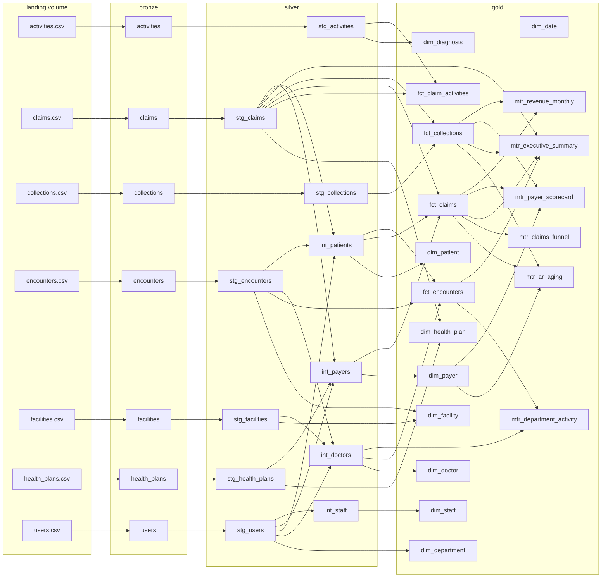

# Unity Catalog lineage for `claimwise`

Recorded automatically by Unity Catalog from the Matillion runs; read through the Databricks lineage API on 2026-11-08.
37 tables, 59 edges. In Databricks, open any table in Catalog Explorer and choose the Lineage tab for the interactive graph.

| upstream | downstream |
|---|---|
| `/Volumes/claimwise/landing/raw/activities/` | `bronze.activities` |
| `/Volumes/claimwise/landing/raw/claims/` | `bronze.claims` |
| `/Volumes/claimwise/landing/raw/collections/` | `bronze.collections` |
| `/Volumes/claimwise/landing/raw/encounters/` | `bronze.encounters` |
| `/Volumes/claimwise/landing/raw/facilities/` | `bronze.facilities` |
| `/Volumes/claimwise/landing/raw/health_plans/` | `bronze.health_plans` |
| `/Volumes/claimwise/landing/raw/users/` | `bronze.users` |
| `silver.stg_users` | `gold.dim_department` |
| `silver.stg_activities` | `gold.dim_diagnosis` |
| `silver.int_doctors` | `gold.dim_doctor` |
| `silver.stg_encounters` | `gold.dim_facility` |
| `silver.stg_facilities` | `gold.dim_facility` |
| `silver.stg_claims` | `gold.dim_health_plan` |
| `silver.stg_health_plans` | `gold.dim_health_plan` |
| `silver.int_patients` | `gold.dim_patient` |
| `silver.int_payers` | `gold.dim_payer` |
| `silver.int_staff` | `gold.dim_staff` |
| `silver.stg_activities` | `gold.fct_claim_activities` |
| `silver.stg_claims` | `gold.fct_claim_activities` |
| `silver.int_patients` | `gold.fct_claims` |
| `silver.int_payers` | `gold.fct_claims` |
| `silver.stg_claims` | `gold.fct_claims` |
| `silver.stg_claims` | `gold.fct_collections` |
| `silver.stg_collections` | `gold.fct_collections` |
| `silver.int_doctors` | `gold.fct_encounters` |
| `silver.int_patients` | `gold.fct_encounters` |
| `silver.stg_encounters` | `gold.fct_encounters` |
| `gold.dim_payer` | `gold.mtr_ar_aging` |
| `gold.fct_claims` | `gold.mtr_ar_aging` |
| `gold.fct_collections` | `gold.mtr_ar_aging` |
| `gold.fct_claims` | `gold.mtr_claims_funnel` |
| `gold.fct_encounters` | `gold.mtr_department_activity` |
| `silver.int_doctors` | `gold.mtr_department_activity` |
| `gold.fct_claims` | `gold.mtr_executive_summary` |
| `gold.fct_collections` | `gold.mtr_executive_summary` |
| `gold.fct_encounters` | `gold.mtr_executive_summary` |
| `silver.stg_claims` | `gold.mtr_executive_summary` |
| `gold.dim_payer` | `gold.mtr_payer_scorecard` |
| `gold.fct_claims` | `gold.mtr_payer_scorecard` |
| `gold.fct_collections` | `gold.mtr_payer_scorecard` |
| `gold.fct_claims` | `gold.mtr_revenue_monthly` |
| `gold.fct_collections` | `gold.mtr_revenue_monthly` |
| `silver.stg_encounters` | `silver.int_doctors` |
| `silver.stg_facilities` | `silver.int_doctors` |
| `silver.stg_users` | `silver.int_doctors` |
| `silver.stg_claims` | `silver.int_patients` |
| `silver.stg_encounters` | `silver.int_patients` |
| `silver.stg_users` | `silver.int_patients` |
| `silver.stg_claims` | `silver.int_payers` |
| `silver.stg_health_plans` | `silver.int_payers` |
| `silver.stg_users` | `silver.int_payers` |
| `silver.stg_users` | `silver.int_staff` |
| `bronze.activities` | `silver.stg_activities` |
| `bronze.claims` | `silver.stg_claims` |
| `bronze.collections` | `silver.stg_collections` |
| `bronze.encounters` | `silver.stg_encounters` |
| `bronze.facilities` | `silver.stg_facilities` |
| `bronze.health_plans` | `silver.stg_health_plans` |
| `bronze.users` | `silver.stg_users` |
